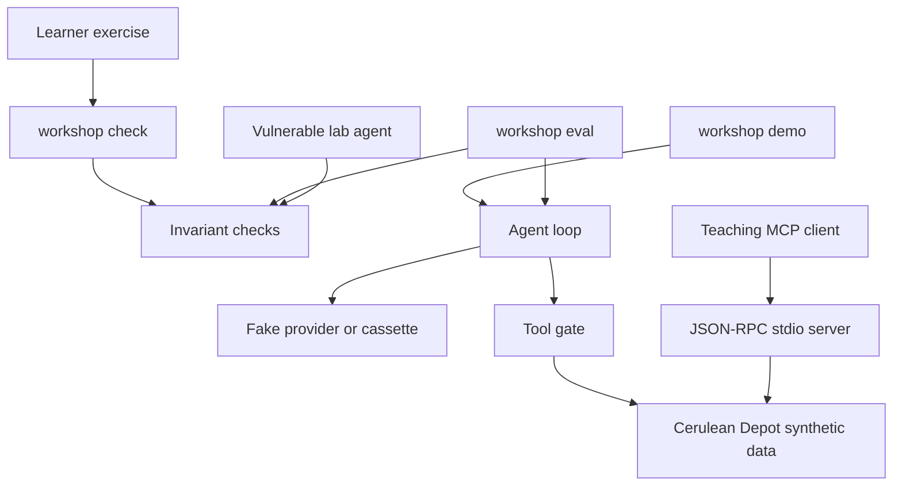
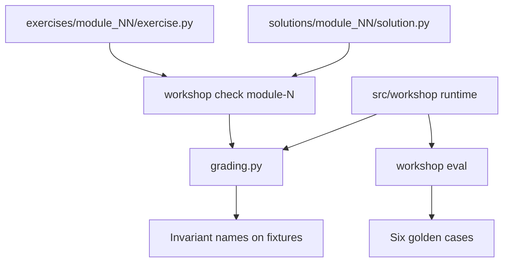

# agents-mcp-evals-workshop

[](https://github.com/dlescanogithub/agents-mcp-evals-workshop/actions/workflows/ci.yml)

**TL;DR**

- Offline workshop on agents, a tiny MCP teaching server, and eval gates. The problem: a tool-calling demo can still have no check that a write happened, that a note was treated as data, or that a run stayed inside a budget.
- Measured result: on 2026-10-18 the offline gate passed 6 of 6 golden cases. Nothing here is a production deployment.
- One command, no network, no API key: `PYTHONPATH=src python -m workshop demo`.

Offline workshop on agents, a tiny MCP teaching server, and eval gates. What is tested is a scripted shift assistant for the fictional Cerulean Depot: invariants on effects, cost, and facts, not a fixed tool-call script.

## Start here

1. Install with `python -m pip install -e ".[dev]"`, then run `PYTHONPATH=src python -m workshop demo`. No API key and no network.
2. Read [modules/01-agent/README.md](modules/01-agent/README.md) and run `PYTHONPATH=src python -m workshop check module-1`. The starter fails until the stop rule is implemented. Add `--impl solution` to see a passing check.
3. If you are deciding whether to host the class, read [docs/BUSINESS_VALUE.md](docs/BUSINESS_VALUE.md). The 2×3 h length is [EST]. The workshop has not been delivered.

## Problem and result

Delivery teams can demo an agent that calls tools and still have no check that a write happened, that a note was treated as data, or that a run stayed inside a budget. The planned length is two sessions of three hours (2×3 h). That duration is [EST]. This workshop has not been delivered. The labs practice those checks with a fake model. Nothing here is a production deployment, and no real client is connected.

Measured result: on 2026-10-18 the offline gate passed **6 of 6** golden cases (package 0.1.1, Python 3.12.3, main commit `496a705e1a21a1d533b57be2160d93e29496d233`, command `PYTHONPATH=src python -m workshop eval`). The same day, `PYTHONPATH=src python -m pytest` reported **48 passed** and **92.79%** coverage of `src/workshop`. The original workshop is PR #1, squash `c590b91` on main. These commands were run on the main commit named above.

Re-measured **2026-10-22** (**MEASURED**) on main commit `9d10f1d4d4dc8045ccb85749204a926bc2dba912`, package 0.1.1, Python 3.12.3. `python -m pytest --cov=workshop --cov-report=term-missing --cov-fail-under=80` printed **48 passed** and **92.79%** total coverage (1456 statements, 105 missed). The same day, on that commit: eval 6 of 6, `checker_vs_reference=5/6`, demo SIMULATED cost 0.00012000 and SIMULATED latency 15 ms, solution modules 1–8 fail=0, secretscan findings=0, eval-regression exit 1, llm-judge exit 2, ruff clean, mypy clean on 79 files. The docs change that records this line does not edit `src/`. The 2026-10-18 lines stay attributed to `496a705e1a21a1d533b57be2160d93e29496d233`.

## Demo

One command, no network, no API key:

```bash
PYTHONPATH=src python -m workshop demo
```

`make demo` is the same command. Structured JSON logs go to stderr. The answer is on stdout. The fake provider replays `src/workshop/data/shift_lookup.json`.

## Business case

For a fictional delivery group ("Taller Bruma"), the session is a way to get a shared bar before anyone turns on a live model: an eval gate on the practice PR, a human grant for writes, and a budget that can refuse a call. The cost of running the labs is zero vendor spend. A worked [EST] sketch of facilitator time and learner time is in [docs/BUSINESS_CASE.md](docs/BUSINESS_CASE.md). This repo does not show money saved in a real organization.

## Business value

Who would buy a workshop like this, the three levers (team enablement, fewer agent incidents, faster eval adoption), the KPI table, the delivery-cost table, and the ROI sketch are in [docs/BUSINESS_VALUE.md](docs/BUSINESS_VALUE.md).

The delivery cost used there is **4,200 USD [EST]** (8 facilitator hours at 75 USD/h plus 72 learner hours at 50 USD/h). The base ROI is about **123.8%** only while a **[SYN]** incident story stays in the benefit. Strip that story and the same hours come out about **−19%**. The workshop has not been delivered. No row was observed. The MEASURED figures are the lab results below, not the percentages.

## Architecture



The capstone calls the same depot handlers the teaching server calls. It does not open a socket. Module 3 is the piece that speaks JSON-RPC over stdio. Detail is in [docs/architecture.md](docs/architecture.md).

## Labs

The 2×3 h length is **[EST]**. Adding the rows below gives 360 minutes. **The workshop has not been delivered.** Module 8 is implemented and is off this clock.

### Agenda

| Block | Minutes [EST] | Module |
| --- | ---: | --- |
| Welcome and pre-reading | 20 | [docs/PRE_READING.md](docs/PRE_READING.md) |
| What is an agent | 50 | [modules/01-agent/README.md](modules/01-agent/README.md) |
| Break | 10 | |
| Tools and the human gate | 60 | [modules/02-tools/README.md](modules/02-tools/README.md) |
| MCP teaching server | 40 | [modules/03-mcp/README.md](modules/03-mcp/README.md) |
| Evals | 50 | [modules/04-evals/README.md](modules/04-evals/README.md) |
| Cost and retries | 30 | [modules/05-cost/README.md](modules/05-cost/README.md) |
| Break | 10 | |
| Injection lab | 40 | [modules/06-injection/README.md](modules/06-injection/README.md) |
| Capstone and the red gate | 50 | [modules/07-capstone/README.md](modules/07-capstone/README.md) |
| Checker and optional LLM judge | off the clock | [modules/08-llm-judge/README.md](modules/08-llm-judge/README.md) |

### Learning outcomes

By the end of module 7 a learner can:

- Classify a turn as `final`, `max_steps`, or another step, including a final answer that lands on the cap (module 1).
- Reject an unknown field, a missing field, a bool passed as an integer, and a write whose name is not in the grant (module 2).
- Send one JSON-RPC request that carries protocol revision `2026-07-28` and read a tool result from the local stdio server (module 3). The official SDK is not used.
- Return the invariant ids that failed, and accept two tool orders when the facts and the effects match (module 4).
- Refuse a model call that does not fit the budget, and cap a retry delay (module 5).
- Quote the lab's malicious note in an answer while the stock stays put. The phrase function is a label (module 6).
- Wire the shift assistant so the happy path, an ungranted adjust, and a cap of 0 all match the grader (module 7).

Module 8, optional: separate the deterministic checker from an LLM judge that stays off unless configured. No live judge result is stored.

### Architecture of the exercises

Each lab is one function in `exercises/module_NN/exercise.py`. The starter raises `NotImplementedError`. `PYTHONPATH=src python -m workshop check module-N` loads that file. `--impl solution` loads `solutions/module_NN/solution.py` instead. `src/workshop/grading.py` calls the function on fixtures and compares invariant names. It does not diff the source.



The CI gate calls the library, not the exercise file, so a blank starter cannot turn CI red. Module 3's check talks to the teaching server over stdio. Module 7's check calls `run_agent` with `FakeProvider`. The capstone does not open a socket. Reference solutions measured 2026-10-22: module 1 pass=6, module 2 pass=8, module 3 pass=7, module 4 pass=6, module 5 pass=7, module 6 pass=5, module 7 pass=3, module 8 pass=2, fail=0 on each.

### How to run each lab

Cost of these commands: zero vendor spend. Leave `WORKSHOP_ENABLE_LIVE_PROVIDER` and `LIVE_MODE` unset.

| Lab | Starter | Reference |
| --- | --- | --- |
| 1 Agent | `PYTHONPATH=src python -m workshop check module-1` | add `--impl solution` |
| 2 Tools | `PYTHONPATH=src python -m workshop check module-2` | add `--impl solution` |
| 3 MCP teaching server | `PYTHONPATH=src python -m workshop check module-3` | add `--impl solution` |
| 4 Evals | `PYTHONPATH=src python -m workshop check module-4` | add `--impl solution` |
| 5 Cost and retries | `PYTHONPATH=src python -m workshop check module-5` | add `--impl solution` |
| 6 Injection | `PYTHONPATH=src python -m workshop check module-6` | add `--impl solution` |
| 7 Capstone | `PYTHONPATH=src python -m workshop check module-7` | add `--impl solution` |
| 8 Checker, optional | `PYTHONPATH=src python -m workshop check module-8` | add `--impl solution` |
| All reference solutions | | `PYTHONPATH=src python -m workshop check all --impl solution` |
| Demo | `PYTHONPATH=src python -m workshop demo` | |
| Gate | `PYTHONPATH=src python -m workshop eval` | exits 0 when 6 of 6 pass |
| Red regression | `PYTHONPATH=src python -m workshop eval-regression` | exits 1. That is the healthy result |
| Optional judge | `PYTHONPATH=src python -m workshop llm-judge` | exits 2 until configured. Not a lab on the clock |

`make demo`, `make eval`, `make test`, and `make check` call the same tools. `make eval-regression` is supposed to exit non-zero.

## Results

**MEASURED 2026-10-22**, package 0.1.1, Python 3.12.3, main commit `9d10f1d4d4dc8045ccb85749204a926bc2dba912`. The same counts were first recorded on 2026-10-18 at `496a705e1a21a1d533b57be2160d93e29496d233`. The original workshop is PR #1, squash `c590b91` on main. Costs below are SIMULATED (see `SIMULATED_USD_PER_TOKEN` in `src/workshop/budget.py`). They are not invoices.

Test command that printed the coverage line: `python -m pytest --cov=workshop --cov-report=term-missing --cov-fail-under=80`. **48 passed. Total coverage 92.79%** (1456 statements, 105 missed). Python **3.12.3**. The percentage is line coverage of the `workshop` package. Exercises and solutions are outside that total.

| Check | Result | Command |
| --- | --- | --- |
| Unit and integration tests | 48 passed, coverage 92.79% | `PYTHONPATH=src python -m pytest` |
| Eval gate | 6 cases, 0 failed | `PYTHONPATH=src python -m workshop eval` |
| Checker vs reference labels written by the author | 5 agreements, 1 disagreement, 6 items | printed by the eval command as `checker_vs_reference=5/6` |
| Optional LLM judge | not run; command exits 2 without configuration | `PYTHONPATH=src python -m workshop llm-judge` |
| Demo | stop `final`, 3 model calls, simulated cost 0.00012000, simulated latency 15 ms | `PYTHONPATH=src python -m workshop demo` |
| Forced regression | exit 1, `regression_result=gate_red`, invariants `no_harmful_effect,claim_mismatch` | `PYTHONPATH=src python -m workshop eval-regression` |
| Solution grader | modules 1–8 fail=0 | `PYTHONPATH=src python -m workshop check all --impl solution` |
| Secret scan | findings=0 | `PYTHONPATH=src python -m workshop secretscan .` |
| Ruff | all checks passed | `python -m ruff check src tests exercises solutions` |
| Mypy | no issues in 79 source files | `python -m mypy` |

The two lookup cases use different tool orders and both pass. That is the trajectory point: the gate asks for the bin and the note, and it asks that stock did not change.

## Use cases, governance and business strategy

### 1. Use cases

Client-style means "shaped like a delivery-team problem." The company names are fictional. Nothing here was taken from a real client.

| Use case | Status | Problem | Who approves | Gated effects | How this repo handles it |
| --- | --- | --- | --- | --- | --- |
| Enablement program for Taller Bruma, a fictional delivery org | Implemented | People can wire a tool loop and still have no shared bar for effects, cost, or untrusted text | Facilitator, with the team's engineering lead if they adopt the pattern | Stock writes and any tool outside the catalog | Seven modules, `workshop check`, and the CI eval gate. No external system is connected. |
| Internal agent guild that reviews new tools | Design only | There is no standing forum in this repo for a second team to propose a tool | A guild chair role, not built | A new tool would need an entry in the catalog and a human grant if it writes | Listed as a later phase in [docs/SCOPE.md](docs/SCOPE.md). No guild workflow is implemented. |

| Use case | Status | Problem | Who approves | Gated effects | How this repo handles it |
| --- | --- | --- | --- | --- | --- |
| Self-study path | Implemented | One person needs to practice the loop without a vendor key | The learner | Same gates as the class | `exercises/`, `solutions/`, and `workshop check module-N` |
| Team lunch-and-learn | Design only | A short slot cannot host the labs | The host | No writes in the outline | [docs/SLIDES_OUTLINE.md](docs/SLIDES_OUTLINE.md) is an outline only |

Design-only vs implemented:

| Item | Status |
| --- | --- |
| Modules 1–7, fake provider, cassettes, grader, CI gate, forced red regression, stdio teaching server | Implemented |
| Deterministic checker vs reference labels written by the author | Implemented. Not a model score |
| Optional module 8 and LLM judge client | Implemented and off by default. Not part of the 2×3 h plan. Not run live. Not in CI |
| Human-label CSV | Template only (`templates/human_labels.csv`). No filled rows |
| Slide deck | Design only (outline) |
| Hosted classroom environment | Design only |
| Vendor modules for a specific model host | Design only. If added later, use only public docs, cited and dated |
| Live provider | Optional adapter, off by default, not used by the gate |

### 2. Governance checklist

| Control | Where it lives |
| --- | --- |
| Tool args are typed; unknown fields are rejected | `src/workshop/tools/auth.py`, module 2 |
| Human approval is a grant set in code, not a sentence in the prompt | `src/workshop/models.py` (`Approval`), `src/workshop/tools/auth.py` |
| Write tools are absent from the MCP export | `src/workshop/tools/specs.py` (`MCP_EXPORTED`) |
| Untrusted note text is not parsed into tool calls on the hardened path | `src/workshop/agent/loop.py` |
| Trace of steps | `src/workshop/tracing.py` (JSONL) and JSON logs in `src/workshop/logging_setup.py` |
| Budget admission check and simulated price | `src/workshop/budget.py` |
| Bounded retries (max attempts and a backoff cap) | `src/workshop/retries.py` |
| Eval gate in CI, no paid API | `.github/workflows/ci.yml`, `src/workshop/evalkit/gate.py` |
| Proof the gate can go red | `python -m workshop eval-regression` |
| Secret scan | `src/workshop/secretscan.py` |
| Deterministic checker vs author reference labels | `src/workshop/evalkit/checker.py` |
| Optional LLM judge, off unless configured, never in CI | `src/workshop/evalkit/llm_judge.py` |
| Risks | [docs/RISKS.md](docs/RISKS.md) |
| Costs | [docs/COST.md](docs/COST.md) |
| Incident and rollback | [docs/RUNBOOK.md](docs/RUNBOOK.md) |

Not covered yet: real identity for the approver, a review queue, vendor authentication, persistent memory, multi-user tenancy, a hosted runner, and a recorded live LLM-judge result. The client exists and stays off.

### 3. Business strategy

The business problem this material is aimed at: a delivery team starts calling tools from a model before it has a definition of a bad effect. The [EST] hours are in [docs/BUSINESS_CASE.md](docs/BUSINESS_CASE.md). The dollar sketch, with the incident term kept separate, is in [docs/BUSINESS_VALUE.md](docs/BUSINESS_VALUE.md). Behaviour metrics are in [docs/METRICS.md](docs/METRICS.md). Scope and phases are in [docs/SCOPE.md](docs/SCOPE.md).

Deployment Strategist conversation: start with discovery ([docs/DISCOVERY.md](docs/DISCOVERY.md)), not with a model name. Run the agent in shadow against a cassette and the invariant gate. Only then talk about a live provider, still behind the same gate. The facilitator owns the classroom and the synthetic data. The engineering lead of the adopting team would own the tool catalog, the grant list, and the golden cases. This repo does not assign those roles to a real team.

## Decisions

- [0001 Fake provider by default](docs/adr/0001-fake-provider-by-default.md)
- [0002 Invariants, not trajectories](docs/adr/0002-invariants-not-trajectories.md)
- [0003 Teaching MCP subset, not the official SDK](docs/adr/0003-teaching-mcp-subset.md)
- [0004 The human gate is code](docs/adr/0004-human-gate-is-code.md)
- [0005 Environment-only configuration](docs/adr/0005-env-only-config.md)

## Security and known limits

What this does NOT do:

- It does not call a paid model API in tests or in CI.
- It does not authenticate a person. `Approval.approver` is a label.
- It does not stop prompt injection by scanning text. The lab phrase detector is a label. The control is that tool calls come from the provider turn, and writes need a grant.
- It does not implement MCP. It implements a small JSON-RPC subset so a class can see frames on stdio. The official SDK is not used. The cited revision is 2026-07-28, accessed 2026-10-17. See [docs/adr/0003-teaching-mcp-subset.md](docs/adr/0003-teaching-mcp-subset.md).
- It does not record real vendor traffic. Cassettes are scripts.
- It does not prove a team is ready to run a live agent. Passing the gate means the synthetic cases passed.
- It does not store secrets. `.env` is gitignored. The live key is never written to the JSON log on purpose (`Settings.public_dict`).

### What this does NOT prove

- A delivered class. The workshop has not been delivered. No learner has been timed or scored. The 360-minute agenda is [EST].
- Fewer agent incidents. `eval-regression` exits 1 on a lab agent that changes stock. That is a teaching alarm. It is not an incident series.
- Faster eval adoption in a repository this workshop does not contain. No pull-request sample exists here.
- That 92.79% line coverage (MEASURED 2026-10-22, Python 3.12.3, 48 passed) means the exercises are complete. The percentage covers `src/workshop`. A missed line is listed in the pytest report. It is not a product claim.
- That 6 of 6 golden cases is a quality score for a model. The provider is fake and ignores the prompt.
- That `checker_vs_reference=5/6` is agreement with a person or with a judge model. The labels were written by the author. The LLM judge exits 2 without configuration.
- That the SIMULATED price or the 15 ms latency is a vendor measurement.
- That the ROI percentages in [docs/BUSINESS_VALUE.md](docs/BUSINESS_VALUE.md) were observed. They are [EST] and [SYN].

More in [SECURITY.md](SECURITY.md) and [docs/RISKS.md](docs/RISKS.md).

## How to reproduce

Cost of a run: zero by default. The fake provider does not use the network. Do not set `WORKSHOP_ENABLE_LIVE_PROVIDER`.

Prerequisites: Python 3.11 or newer (measured here on 3.12.3), git. `make` is optional.

Audience: delivery engineers who will sit next to an agent feature. Comfort with Python functions and JSON is enough. No vendor account.

Learning outcomes, the [EST] agenda, the exercise architecture, and the per-lab commands are in [Labs](#labs).

Setup and commands. If `make` is missing, use the `python -m` line.

```bash
python -m pip install -e ".[dev]"    # make setup
python -m ruff check src tests exercises solutions
python -m ruff format --check src tests exercises solutions
python -m mypy                        # make lint runs ruff and mypy
python -m pytest                      # make test
python -m workshop eval               # make eval
python -m workshop demo               # make demo
python -m workshop check module-1     # starter, expected to fail until you implement it
python -m workshop check module-1 --impl solution
```

`make eval-regression` is supposed to exit non-zero. A red result means the gate noticed the lab agent changed stock. CI treats exit code 1 as the success condition for that step.

Module 8 is optional and is not on that agenda. `python -m workshop llm-judge` exits 2 until `LIVE_MODE=1` and the `LLM_*` variables are set. CI does not run it. The results table in [modules/08-llm-judge/README.md](modules/08-llm-judge/README.md) is empty.

Copy `.env.example` to `.env` only on your machine if you want the variables set. The program reads the process environment. It does not open `.env` itself.

## Next steps

- Keep the gate green when a case is added. Add a case by effects and facts, not by locking a tool order.
- A slide file and a hosted runner are intentionally not in this repo.
- A vendor-specific module, if someone writes one later, has to cite public docs with the access date and stay out of CI.
- An adopting team would replace Cerulean Depot with their own read-only lookup behind the same grant rule. See [docs/ADAPT_TO_A_REAL_CLIENT.md](docs/ADAPT_TO_A_REAL_CLIENT.md).

## Docs index

- [Narrated recording of a real offline run, with number trace](docs/demo/)
- [How the workshop works](docs/HOW_IT_WORKS.md)
- [Business case](docs/BUSINESS_CASE.md)
- [Business value](docs/BUSINESS_VALUE.md) — who would buy the class, levers, KPIs, [EST] delivery cost, ROI sketch. The workshop has not been delivered.
- [Discovery questions](docs/DISCOVERY.md)
- [Scope](docs/SCOPE.md)
- [Risks](docs/RISKS.md)
- [Metrics](docs/METRICS.md)
- [Cost](docs/COST.md)
- [Runbook](docs/RUNBOOK.md)
- [Architecture](docs/architecture.md)
- [Adapt to a real client](docs/ADAPT_TO_A_REAL_CLIENT.md)
- [Provenance](docs/PROVENANCE.md)
- [Facilitator guide](docs/FACILITATOR.md)
- [Learner handout](docs/LEARNER_HANDOUT.md)
- [Pre-reading](docs/PRE_READING.md)
- [Answer key](docs/ANSWER_KEY.md)
- [Feedback form](docs/FEEDBACK_FORM.md)
- [Slides outline (design only)](docs/SLIDES_OUTLINE.md)
- [Decisions](docs/adr/)

## Authorship and how this was built

This repository was built with AI-assisted development.

**Author (Diego Lescano):**
- Chose the problem and the scope: which failure to show, what is out of scope, and what the repo must not claim.
- Set the governance and business-strategy requirements for every case: approval controls, traceability, risks and costs, estimated ROI, rollout and metrics.
- Set the engineering standards: Python, tests, CI, synthetic data only, no real client or employer data.
- Reviewed and approved each change before merge, and decided what became public and when.

**AI coding agents:**
- Wrote most of the code, tests and documentation, from the author's briefs and under the author's review.

**What this repo does not claim:**
- It is not a production system, and every data set is synthetic.
